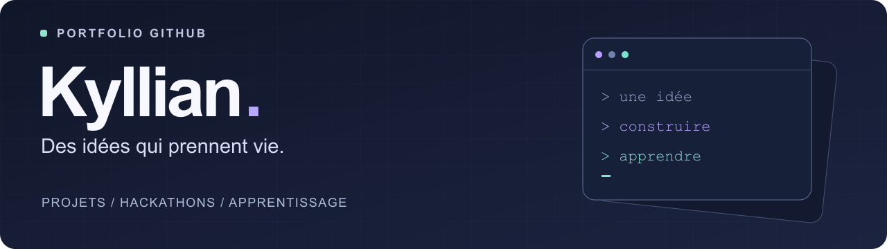

# Salut, moi c’est Kyllian 👋

Étudiant en 1ʳᵉ année, je développe mes compétences à travers des projets personnels et des hackathons. J’aime transformer une idée en un projet concret et apprendre en construisant.

> **Je recherche un stage de 2 à 3 mois dans le cadre de ma 1ʳᵉ année.**  
> Pour échanger : [retrouvez-moi sur LinkedIn](https://www.linkedin.com/in/kyllian-lamirand-0084a5277/).

[Projets](#projets) · [Hackathons](#hackathons) · [CV et parcours](#cv-et-parcours) · [Contact](#contact)

<!-- Quand le CV est prêt, ajouter assets/CV-Kyllian-Lamirand.pdf, puis insérer ici :
[Consulter mon CV en anglais](assets/CV-Kyllian-Lamirand.pdf)
-->

## Projets

### Jefe — rendre la cuisine plus ludique

Une application iOS autour des défis culinaires et de la gamification : transformer la cuisine du quotidien en une expérience motivante et sociale.

- **Contexte :** projet du Build Challenge Apple / MWM / Command F.
- **Résultat :** **4ᵉ sur 11**.
- **Technologies :** Swift, SwiftUI.

[Voir le projet et son code](https://github.com/Kyllianlam/jefe-app-ios)

<!-- Ajouter ici une phrase sur ta contribution personnelle, puis une capture ou une démo publique.
Exemple de structure à adapter : « Ma contribution : conception de [fonctionnalité] et développement de [périmètre]. »
-->

### R0 — prochain projet de hackathon

Un projet en préparation pour un prochain hackathon. Je partagerai ici le concept, ma contribution et la démonstration à mesure que le projet prendra forme.

**Statut :** en préparation.

<!-- Ajouter le nom officiel de l’événement et l’institution concernée après confirmation.
Ajouter un lien uniquement lorsqu’un dépôt ou une présentation peut être partagé publiquement.
-->

## Hackathons

| Événement | Projet | Résultat / statut |
| :--- | :--- | :--- |
| Build Challenge Apple / MWM / Command F | [Jefe](https://github.com/Kyllianlam/jefe-app-ios) | **4ᵉ / 11** |
| Prochain hackathon — détails à venir | R0 | **En préparation** |

<!-- Ajouter les dates et un lien vers les résultats officiels lorsqu’ils sont disponibles.
Préciser « équipes » ou « projets » après confirmation de ce que représente le total de 11.
-->

## Ce que j’utilise

**Sur Jefe :** `Swift` · `SwiftUI`  
Les projets ci-dessus donnent un aperçu concret de mon travail et de ma progression.

<!-- Ajouter d’autres compétences uniquement avec un projet, une expérience ou une contribution pour les illustrer. -->

## CV et parcours

Je recherche un **stage de 1ʳᵉ année de 2 à 3 mois**. Une nouvelle version de mon CV en anglais sera ajoutée ici prochainement.

[Voir mon parcours sur LinkedIn](https://www.linkedin.com/in/kyllian-lamirand-0084a5277/)

<!-- Une fois le PDF ajouté, remplacer la phrase sur le futur CV par :
[Consulter mon CV en anglais · PDF](assets/CV-Kyllian-Lamirand.pdf)
Ajouter ensuite l’école, le domaine de stage et les dates de disponibilité.
-->

## Contact

Une opportunité de stage, une idée de projet ou un hackathon à proposer ?  
[Échangeons sur LinkedIn](https://www.linkedin.com/in/kyllian-lamirand-0084a5277/).
